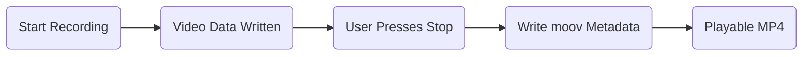
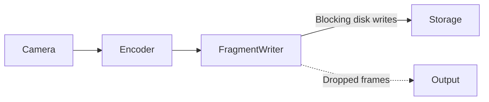
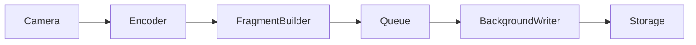
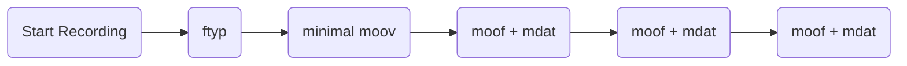
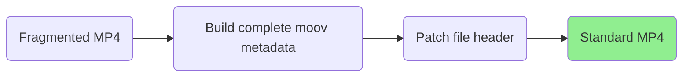
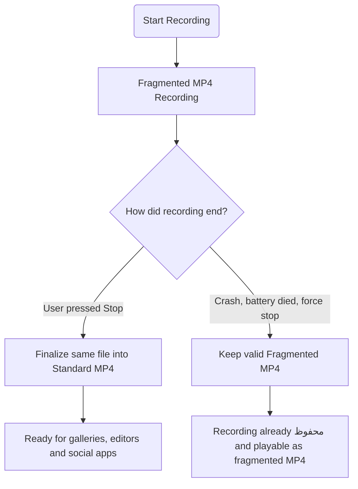

# Hybrid MP4: Combining Crash Safety with Universal Compatibility

For years, recording applications have forced users into a tradeoff.

You could record as a standard MP4 and enjoy excellent compatibility with galleries, video editors, and social media apps. But if your phone ran out of battery, the app crashed, or the operating system unexpectedly terminated the recording before you pressed **Stop**, the video might never be finalized correctly.

Or you could record as **fragmented MP4 (fMP4)**, where the recording remains valid even if something interrupts it unexpectedly. The downside? Many galleries, editors, and social media platforms either refuse to open fragmented MP4 files or only offer limited support.

Neither option felt right.

At FadSec Lab, we believed users shouldn't have to choose between **reliability** and **compatibility**.

This article tells the story of how we spent several months evolving FadCam's recording pipeline into what is now **Hybrid MP4**, combining the strengths of both approaches while keeping the entire implementation open source.

## TL;DR

If you only care about what changed, here's the short version.

- Recording now remains crash-safe while capture is in progress.
- When you stop recording normally, the **same file** is instantly finalized into a standard MP4.
- There is no video re-encoding.
- There is no duplicate file.
- There is no lengthy conversion process.
- If recording is interrupted unexpectedly, the recording remains a valid fragmented MP4 exactly as before.

From the user's perspective, nothing changes.

Press **Record**.

Press **Stop**.

Your video is immediately ready to use almost everywhere.

And if the unexpected happens before you press Stop, your recording is still there.

## Why This Problem Exists

To understand why Hybrid MP4 matters, it's worth understanding how a traditional MP4 file is created.

Most MP4 recordings are only fully completed after recording stops. During finalization, the recorder writes a metadata structure called the **`moov` atom**, which tells video players where every frame and audio sample is stored.

Without that metadata, many players simply don't know how to read the file.

This works perfectly until something unexpected happens.

If the phone loses power, the app crashes, or the operating system terminates the recording before the metadata is written, the recording may never become a valid standard MP4.

For many applications this is an acceptable compromise.

For a dashcam or bodycam application, it isn't.

The moments when something unexpected happens are often the moments users care about preserving the most.

That's exactly the problem we wanted to solve.

## Our First Step: Moving to Fragmented MP4

The first major change we made was switching FadCam's recording pipeline from standard MP4 to **fragmented MP4 (fMP4)**.

Instead of waiting until the very end of a recording to organize everything into a complete MP4 file, fragmented MP4 writes the recording in a series of independent fragments as recording progresses.

This changes one very important thing.

If recording is interrupted unexpectedly, everything that has already been written remains a valid fragmented MP4 file. There is no missing metadata waiting to be written at the end of the recording.

For FadCam, this was a huge improvement.

Whether the phone suddenly lost power, Android force stopped the app, or recording ended unexpectedly for any other reason, users no longer lost their entire recording. Everything captured up to that moment was already safely stored.

For a dashcam or bodycam application, that's exactly the behavior we wanted.

## But Fragmented MP4 Introduced a New Problem

Crash safety came with its own tradeoff.

Although fragmented MP4 is part of the MP4 specification, support across applications is still inconsistent.

Many gallery apps can play fragmented MP4 files without any issue.

Others cannot.

Some social media apps refuse to import them altogether.

Video editors often expect a traditional MP4 layout as well.

From a user's perspective, this was understandably confusing.

The recording existed.

The video was perfectly valid.

But depending on which app was used, it might appear unsupported until it was converted into a traditional MP4.

That wasn't the experience we wanted either.

## Looking for a Better Solution

At first, we assumed there would already be a solution.

Surely someone had already solved the problem of combining fragmented MP4's crash safety with the compatibility of a traditional MP4.

We spent weeks reading specifications, experimenting with existing libraries, studying open source projects, and testing different approaches.

Along the way, we came across the excellent work of **Albin Råstander (@albrast)**, who had been exploring callback-based fragmented MP4 output for AndroidX Media3.

His work introduced several important improvements for streaming, including callback-based fragment delivery through a `Consumer<ProcessedSegment>` architecture and support for Media Source Extensions (MSE).

Rather than starting from scratch, we forked his work and continued building on top of it for FadCam's recording pipeline.

That became the foundation for everything that followed.

Around the same time, we also discovered the **Hybrid MP4** approach introduced by the **OBS Studio** team.

OBS solved a very similar problem on desktop systems.

Instead of forcing users to choose between crash safety and compatibility, it records using fragmented MP4 while recording is in progress, then transforms the same file into a standard MP4 when recording ends normally.

That immediately caught our attention.

The concept was elegant.

The challenge was that AndroidX Media3 had no equivalent implementation.

If we wanted the same experience on Android, we would have to build it ourselves.

But before we could even think about Hybrid MP4, there were still several problems inside our recording pipeline that needed to be solved first.

## Building the Foundation

At this point, we had a clear direction, but we quickly realized that Hybrid MP4 wasn't something we could simply "add" to AndroidX Media3.

The stock fragmented MP4 writer was designed for writing directly to a file. Our recording pipeline had different requirements.

Besides saving recordings locally, FadCam also supports live HLS streaming. That meant every completed fragment needed to be available immediately so it could be sent over the network while recording continued in real time.

Fortunately, Albin Råstander's callback-based Media3 implementation already laid the groundwork for this by delivering completed fragments through a `Consumer<ProcessedSegment>` callback instead of writing everything directly to disk.

That architecture became the starting point for our own Media3 fork.

From there, we continued extending the library to fit FadCam's recording pipeline.

### The First Surprise

Everything appeared to work during initial testing.

Fragments were being generated correctly.

Streaming worked.

Recordings were saved successfully.

Then we started testing longer recordings.

Every few seconds, the video would briefly freeze before continuing.

The recording itself never stopped, but playback contained small stutters that repeated throughout the video.

At first we suspected the camera.

Then the encoder.

Then the renderer.

After several rounds of profiling and debugging, we eventually discovered the real bottleneck.

Every time a fragmented MP4 segment was finalized, Media3 performed file writing on the recording pipeline itself.

Writing several megabytes to storage every few seconds might not sound expensive, but on a real-time recording pipeline, even brief blocking operations can delay incoming camera frames.

Those delayed frames were being dropped, creating the periodic stutter we were seeing.

The recording pipeline wasn't overloaded.

It was simply waiting.

### Moving Disk Writes Off the Recording Pipeline

The solution was to separate fragment generation from fragment writing.

Instead of writing each completed fragment immediately, completed fragments are now placed into a queue.

A dedicated background writer thread continuously removes fragments from that queue and writes them to storage independently.

This allows the encoder to continue processing camera frames without waiting for storage operations to finish.

Although this sounds like a relatively small architectural change, it completely eliminated the periodic frame drops we had been chasing.

Long recordings became noticeably smoother because fragment finalization no longer interrupted the recording pipeline.

This asynchronous writing model also became an important building block for everything that came next.

### Making Fragments Truly Independent

There was one more issue.

For local playback, the default fragmented MP4 layout produced by Media3 worked perfectly.

For streaming, however, every fragment should be independently usable.

The stock implementation stored fragment offsets relative to the beginning of the entire recording.

That works when every fragment remains inside one file.

It becomes a problem when fragments are transmitted individually over the network.

To solve this, we modified the muxer to enable the `default-base-is-moof` flag.

Instead of referencing locations relative to the beginning of the complete recording, every fragment now becomes self-contained with offsets relative to its own `moof` box.

That small change significantly improved interoperability with HLS workflows and brought our Media3 fork much closer to the behavior expected by streaming clients.

By this point, the recording pipeline had become stable, efficient, and streaming friendly.

Only one major problem remained.

Users still had to choose between fragmented MP4 for reliability and standard MP4 for compatibility.

## The Final Piece: Hybrid MP4

By this point, we had solved several problems.

Streaming worked reliably.

Periodic recording stutter had been eliminated.

Fragmented MP4 recordings were resilient against unexpected interruptions.

But one inconvenience remained.

Users still had to convert fragmented MP4 recordings before sharing them to many social media apps or opening them in software that only understood traditional MP4 files.

We wanted to remove that extra step without sacrificing the reliability we had worked so hard to achieve.

Around this time, we came across an engineering article published by the **OBS Studio** team introducing **Hybrid MP4**.

The idea was brilliantly simple.

Instead of choosing between fragmented MP4 and standard MP4, why not use both?

Keep recording as fragmented MP4 while capture is in progress, then, if recording ends normally, transform that same file into a standard MP4 almost instantly.

No re-encoding.

No duplicate file.

No lengthy remux operation.

If recording never reaches that final step because of a crash, power loss, or system interruption, nothing is lost. The recording simply remains a perfectly valid fragmented MP4, exactly as it had been throughout recording.

It solved the exact problem we had been trying to solve.

The challenge was that AndroidX Media3 had no implementation of this workflow.

That meant bringing the concept to Android required extending the Media3 muxer itself.

## Adapting Hybrid MP4 for AndroidX Media3

Rather than creating another conversion tool after recording, we decided to make the recording pipeline itself produce the desired result.

During recording, nothing changes.

Media3 continues writing a standard fragmented MP4 exactly as before.

Only when the user presses **Stop** does the new logic take over.

Instead of creating another file or copying gigabytes of video data, the pipeline performs a lightweight finalization step on the existing recording.

The actual video and audio data never move.

Only metadata is written.

Because metadata is tiny compared to video, this process typically completes in milliseconds, even for very large recordings.

For users, it simply feels like the recording finishes normally.

Behind the scenes, however, the recording pipeline has quietly transformed the same file into something almost every gallery, media player, video editor, and social media application already understands.

## What Changed Inside Media3

Making this work required changes inside the fragmented MP4 writer itself.

Among the most significant additions were:

- Reserving a small placeholder immediately after the MP4 header that can be patched during finalization.
- Building a complete standard `moov` atom from the samples accumulated during recording.
- Generating proper sample tables that map every audio sample and video frame to its location in the file.
- Automatically selecting 32-bit (`stco`) or 64-bit (`co64`) chunk offsets depending on the final file size to maximize compatibility across media applications.

Although the finalization step appears almost instantaneous, it is only possible because the muxer has been collecting the information required to build those metadata tables throughout the entire recording.

The recording itself never changes.

Only the file's structure does.

## One Recording Pipeline, Two Outcomes

The result is surprisingly simple.

If recording ends normally, users receive a standard MP4 that's immediately ready to use.

If recording is interrupted unexpectedly, users still have a valid fragmented MP4 containing everything recorded up to that moment.

The important detail is that **both outcomes come from the same recording pipeline**.

Nothing is duplicated.

Nothing is re-encoded.

Nothing needs to be manually recovered.

The pipeline simply finishes in different ways depending on how the recording ends.

For us, this finally achieved the goal we had been working toward for months.

Users no longer have to choose between reliability and compatibility.

They now get both.

## Looking Back

When we first started this project, it looked surprisingly straightforward.

Record using fragmented MP4 for crash safety, then somehow make it behave like a standard MP4 when recording finishes.

In reality, it turned into months of debugging, profiling, reading specifications, and repeatedly redesigning parts of the recording pipeline.

Along the way we solved problems we hadn't even anticipated.

We tracked down periodic recording stutter caused by synchronous fragment writing.

We improved the recording pipeline for HLS streaming.

We extended AndroidX Media3 with new functionality that simply didn't exist before.

And finally, we brought Hybrid MP4 support to our Media3 fork, allowing a recording to remain crash-safe while automatically becoming a standard MP4 when the user stops recording normally.

Looking back, Hybrid MP4 wasn't a single feature.

It was the result of many smaller engineering improvements that gradually transformed the entire recording pipeline.

The final user experience is intentionally simple.

Press **Record**.

Press **Stop**.

Your video is immediately ready to use.

If recording is interrupted unexpectedly, the video you've already recorded is still safe.

That's exactly how we think recording software should behave.

## Building on Open Source

This project would not have been possible without the open source community.

While researching AndroidX Media3, we came across **Albin Råstander's** experimental callback-based fragmented MP4 implementation. His work laid an important foundation for callback-driven fragment delivery and streaming support, which we built upon and extended for FadCam's recording pipeline.

Later, we discovered the **Hybrid MP4** design published by the **OBS Studio** team. Although their implementation targets desktop recording software, the concept inspired our own implementation for AndroidX Media3.

We encourage anyone interested in the implementation details to explore the projects below.

## References

- **FadCam**
  https://github.com/anonfaded/FadCam

- **Patched AndroidX Media3**
  https://github.com/anonfaded/media3-patched

- **OBS Studio — Hybrid MP4**
  https://obsproject.com/blog/obs-studio-hybrid-mp4

- **Albin Råstander's Media3 prototype**
  https://github.com/albrast/media/tree/feat/live-fragmented-muxer

---

Engineering is often about standing on the shoulders of others.

This project is no exception.

We learned from existing ideas, adapted them to a different platform, solved the challenges unique to Android, and shared the result publicly so others can build on it as well.

If you're building your own recording pipeline, we hope this project saves you some of the months we spent getting here.